# World Model-Based Autonomous Drone Racing with Hierarchical Control

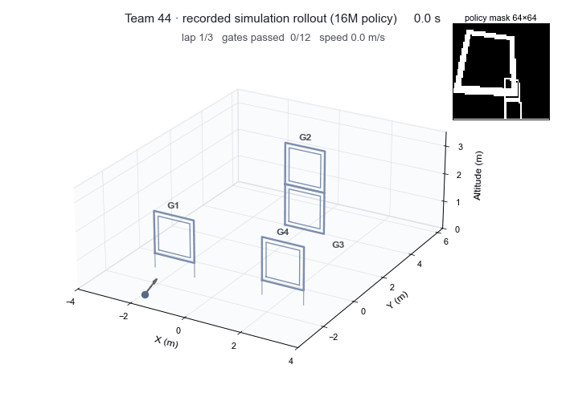

A world-model policy (Informed DreamerV3) reads **gate masks + IMU** and outputs
**collective thrust, roll/pitch angle and yaw rate (CTBA)**. A commercial flight controller
(Betaflight, angle mode) tracks these commands. Training runs in a CTBA simulator identified from manual
flight logs of our own quadrotor, on a split-S track that replicates our indoor arena.

| | |
|---|---|
| Three-lap success | **79.7%** (600 randomized flights, takeoff from the floor) |
| One-lap success | **91.7%** |
| Median three-lap time / top speed | **14.1 s / 6.0 m/s** |
| Gate check | the whole airframe must pass inside every gate opening |
| Sim-to-real | **ongoing**: hardware, track and onboard pipeline are ready ([details](#sim-to-real-ongoing)) |

Code: branch [`ctba`](https://github.com/B-logg/E2E-Autonomous-DroneRacing/tree/ctba/hierarchy_control) (`hierarchy_control/`).

---

## Results (simulation)

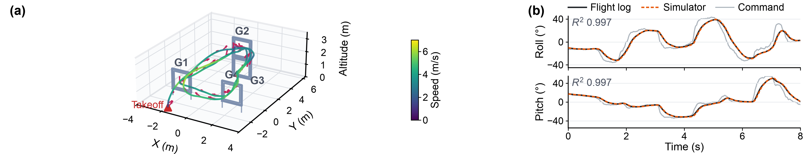

(a) Representative three-lap flight of the final policy: 13.9 s, peak 6.0 m/s; arrows show the camera axis.
(b) A manual track flight replayed in the CTBA simulator with the logged inputs: log (black), simulator (orange), command (gray).

| Metric (600 flights each) | Stage-2 end (8M steps) | Final policy (16M steps) |
|---|---|---|
| 1-lap success | 81.8% | **91.7%** |
| 3-lap success | 44.7% | **79.7%** |
| Crashes (gate / floor / wall) | 299 / 32 / 1 | 117 / 4 / 1 |
| Median time (1 / 3 laps) | 4.5 / 14.4 s | 4.4 / 14.1 s |
| Median top speed (3 laps) | 6.0 m/s | 6.0 m/s |

Both success rates are higher at 16M (two-proportion z-test: z = 5.0 / 12.5, p < 0.001).
Evaluation: randomized dynamics and delays ([table below](#hierarchical-control-and-the-ctba-simulator)), takeoff from the floor 1.8–2.0 m before G1,
gates passed in order without collision.

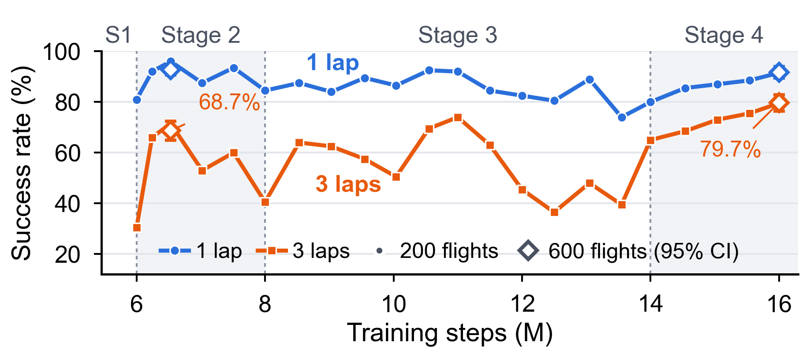

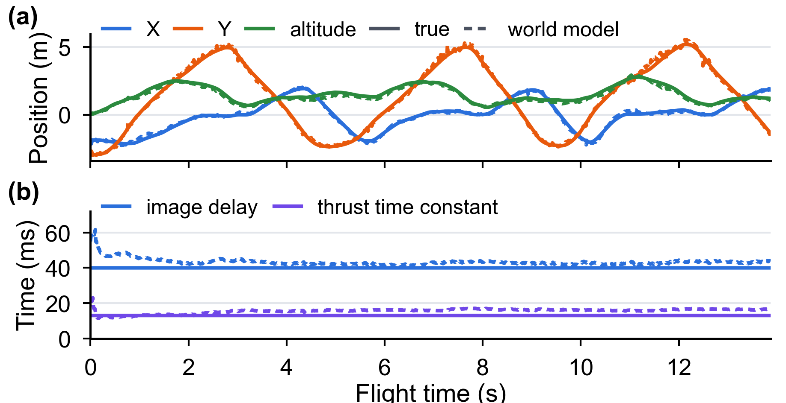

The world model decodes privileged state from masks + IMU during the same flight: (a) position, (b) image delay
and thrust time constant (solid: true, dashed: decoded).

---

## Method

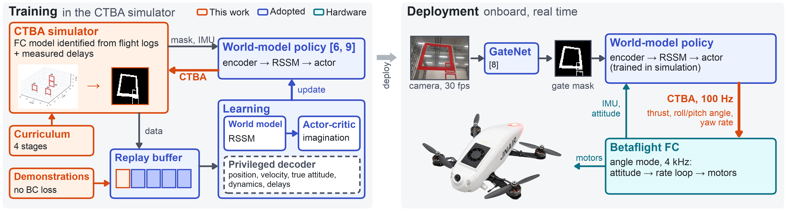

### Hierarchical control and the CTBA simulator

| Layer | Runs on | Rate | Role |
|---|---|---|---|
| Policy (encoder + RSSM + actor) | Jetson Orin Nano | 100 Hz | gate mask + IMU + FC attitude + flight plan → CTBA |
| Betaflight angle mode | SpeedyBee F405 V4 | 4 kHz | attitude estimate → angle loop → rate loop → motor mixing |

The simulator reproduces the FC's closed-loop response instead of motors and propellers: angle loop (gain K_L),
2nd-order roll/pitch and 1st-order yaw rate response, thrust with delay and time constant, rigid-body dynamics,
and Betaflight's Mahony attitude estimator. Everything is identified from Blackbox logs of manual angle-mode flights.

| Parameter | Nominal | Training | Evaluation |
|---|---|---|---|
| Level gain K_L (1/s) | 4.9 | 4.6–5.2 | 4.6–5.2 |
| Rate ω_n/2π, roll/pitch (Hz) | 18.3 / 11.0 | ×0.8–1.25 | ×0.8–1.25 |
| Damping ζ, roll/pitch | 0.49 / 0.51 | 0.35–0.8 | 0.35–0.8 |
| Yaw τ_z (ms) | 22 | 13–35 | 13–35 |
| Estimator gain k_p | 0.25 | 0.22–0.28 | 0.22–0.28 |
| Thrust delay / τ_T (ms) | 10 / 17 | 5–15 / 12–30 | 5–15 / 12–30 |
| Image delay (ms) | 46–65 (measured) | 40–70 | 40–70 |
| Mask rate (fps) | 30 | 25–30 | 25–30 |
| Action delay (ms) | 1.8–2.3 (measured) | 10–20 | 10–20 |
| Camera tilt (°) | 30 | 25–35 | 25–35 |
| Disturbance (m/s²) | – | ±3 | ±2 |
| Floor takeoff (%) | – | 30 | 100 |

30 parameters and the delays are randomized every episode.

### World-model policy

| | |
|---|---|
| Algorithm | Informed DreamerV3: the world model also decodes privileged state (training only) |
| Observation | 64×64 gate mask (30 fps), gyro, accelerometer, FC roll/pitch estimate, flight plan (next three gates) |
| Privileged decoder | position, velocity, true attitude, FC estimate error, dynamics parameters, delays |
| Action | throttle, roll/pitch target angle (±55°), yaw rate |
| Imagination | 16-step latent rollouts for the actor and critic |
| Reward | progress + gate passage near the opening center; penalties on body rate, speed above the cap, unstoppable descent, low altitude |

### Demonstrations and curriculum

Demonstrations: 800 collision-free episodes of a path-following CTBA controller (2.5 m/s, ≥ 8 gates; 1.6M steps)
put in the replay buffer before training, with **no behavior-cloning loss**.

| Stage | Steps | Speed cap | Gate window | Floor/altitude penalty + airframe check | Sequence length | Stage-end success (1 / 3 laps, 200 flights) |
|---|---|---|---|---|---|---|
| 1 | 0–6M | – | 0.60 m | – | 64 | 81.0 / 30.5% |
| 2 | 6–8M | 4 m/s | 0.60 m | – | 256 | 84.5 / 40.5% |
| 3 | 8–14M | 4 m/s | 0.45 m | ✓ | 256 | 80.0 / 65.0% |
| 4 | 14–16M | 4 m/s | 0.45 m | ✓ | 256 | **91.5 / 79.5%** |

Stage 4 lowers the entropy coefficient (1e-5) and learning rate (2e-6). Each stage continues the previous
networks and replay buffer.

### GateNet

| | |
|---|---|
| Architecture | U-Net (SkyDreamer), multi-scale mask outputs |
| Data | 545 labeled frames of our gates (HSV auto-label + manual review) |
| Validation IoU | **0.929** |
| Onboard time | 3.2 ms on the Jetson Orin Nano |

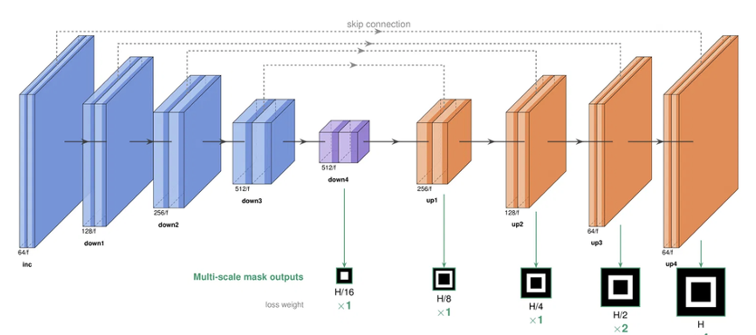

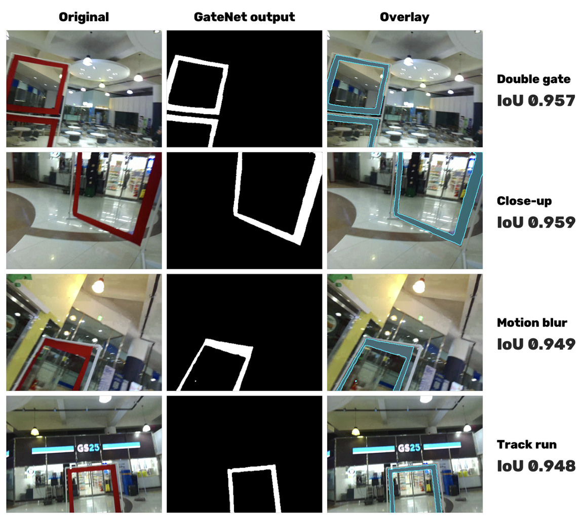

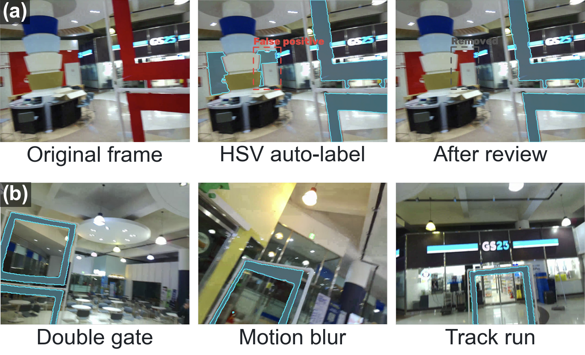

### StochGAN

A generator that turns clean rendered masks into GateNet-like masks (broken edges, thinner frames, spurious
blobs). Rows: rendered mask, generator after 50 epochs, after 150 epochs. A fine-tuning stage on these masks is
implemented on branch `ctba` (`./run.sh --finetune-stochgan <snapshot>`, stage `c4g`, test `ceg`); the reported
policy above is trained on rendered masks with rolling-shutter and erosion augmentation.

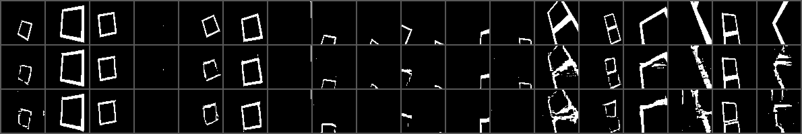

---

## Sim-to-real (ongoing)

**Sim-to-real ongoing.** The airframe, track and onboard pipeline are built and measured; closed-loop policy
flights on the physical drone are in progress.

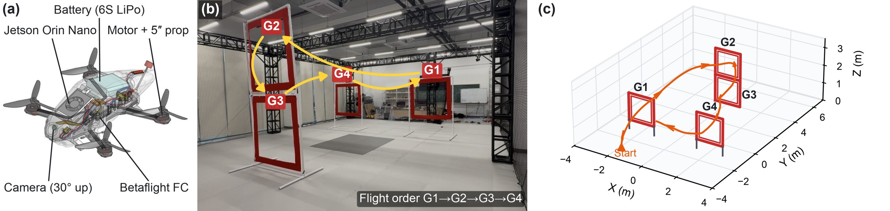

(a) Team-built 0.95 kg quadrotor (thrust-to-weight ratio 5.5): Jetson Orin Nano, camera 30° up, Betaflight FC,
6S, 5-inch props. (b) Track in the 8 × 11 × 3.5 m arena; G2 on G3 forms a split-S. (c) Gate layout in the simulator.

| Built airframe | Arena test setup |
|---|---|
| 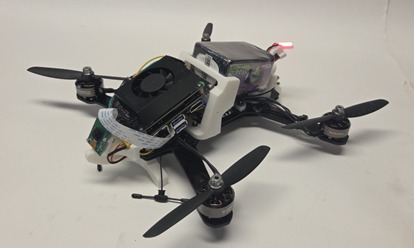 | 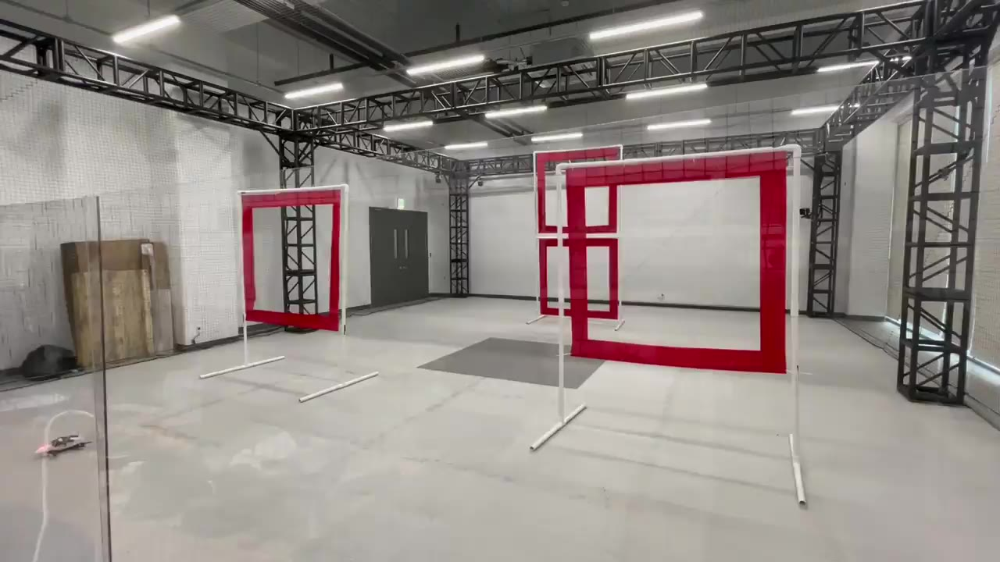 |

| Step | Status | Evidence |
|---|---|---|
| Airframe and track | ✅ done | 0.95 kg, TWR 5.5; 4 gates (1.2 m opening) in an 8 × 11 × 3.5 m arena |
| FC response identification | ✅ done | replaying manual flight logs in the simulator: attitude R² 0.995–0.999, RMS 0.2–0.6° (command-as-attitude: R² 0.67–0.93) |
| Onboard latency | ✅ done | see table below |
| GateNet on the venue camera | ✅ done | val IoU 0.929, 3.2 ms on the Jetson |
| Onboard pipeline | ✅ done | camera → GateNet → policy → MSP → Betaflight angle mode |
| Closed-loop policy flights | 🔄 in progress | arena tests on the physical drone |

| Measured latency | Value |
|---|---|
| Camera pipeline (exposure → frame on the Jetson) | 42–47 ms |
| Undistortion | 0.5 ms |
| GateNet | 3.2 ms |
| Wait for the next policy step | 0–10 ms |
| Jetson-side serial link (MSP, median–p99) | 1.8–2.3 ms |
| FC-side (RC smoothing + PID → motor, Blackbox) | 2.5–3.5 ms |

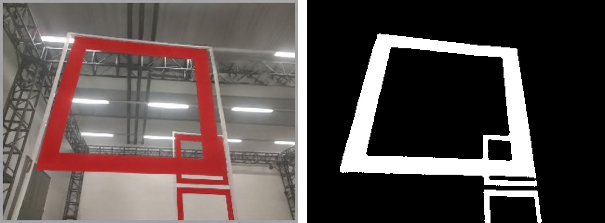

Onboard camera frame in the arena and its GateNet mask.

---

## Code (branch `ctba`)

| Path | Contents |
|---|---|
| [`hierarchy_control/ctba/`](https://github.com/B-logg/E2E-Autonomous-DroneRacing/tree/ctba/hierarchy_control/ctba) | CTBA plant, randomization, environment, curriculum tasks, demonstrations |
| [`hierarchy_control/sysid/`](https://github.com/B-logg/E2E-Autonomous-DroneRacing/tree/ctba/hierarchy_control/sysid) | FC identification from Betaflight Blackbox logs, replay check |
| [`hierarchy_control/jetson_bench/`](https://github.com/B-logg/E2E-Autonomous-DroneRacing/tree/ctba/hierarchy_control/jetson_bench) | Jetson inference + MSP latency benchmark |
| [`hierarchy_control/scripts/`](https://github.com/B-logg/E2E-Autonomous-DroneRacing/tree/ctba/hierarchy_control/scripts) | training, evaluation and analysis scripts |
